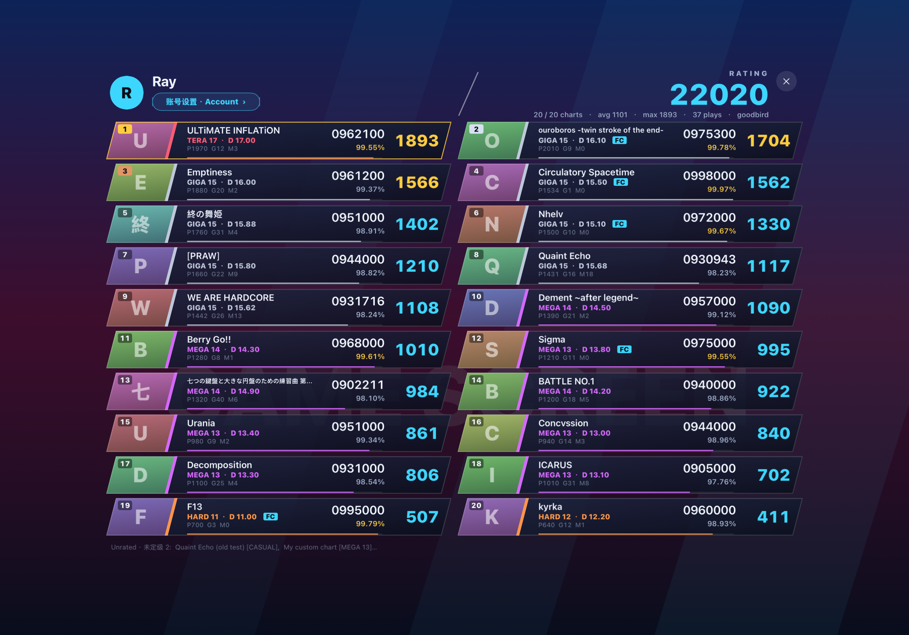
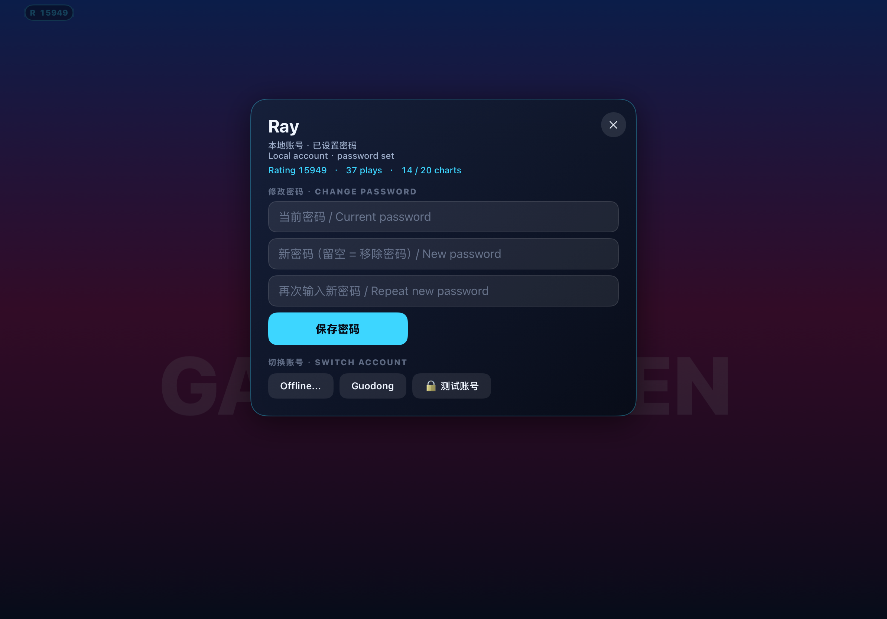

# Dynamite Offline Rating

在 iOS 版 **Dynamite（炸药）** 里恢复离线的个人 Rating：打完每首谱面自动记录成绩、在本机计算 R 值和 Best 20、显示成绩看板，并支持本地账号。
官服已经关闭，所有数据都只存在你自己的设备上，**不联网、不上传任何东西**。

Offline personal **Rating** for the iOS client of the rhythm game **Dynamite**. Every finished chart is recorded automatically, the per-chart R and the
Best-20 total are computed on the device, shown on a Best 20 page, and local accounts are supported. The official servers are gone; nothing is
uploaded anywhere.

| Best 20 (sample data) | Account settings (sample data) |
|---|---|
|  |  |

## 下载与安装 · Download and install

**[下载 iOS IPA · Download iOS IPA](https://github.com/Jelly-RayTian/dynamite-offline-rating/releases/download/v1.0.0/Dynamite-1.0.2-OfflineRating-unsigned.ipa)** · [v1.0.0 Release](https://github.com/Jelly-RayTian/dynamite-offline-rating/releases/tag/v1.0.0) · [OfflineRating.dylib](https://github.com/Jelly-RayTian/dynamite-offline-rating/releases/download/v1.0.0/OfflineRating.dylib)

IPA 基于 Dynamite 1.0.2（build 59），已内置 Offline Rating。下载的是未签名版，可用 Sideloadly 或 AltStore 重新签名并安装。安装后，在「文件」App 中将谱面文件放进 Dynamite 的 `Documents`，并按导入教程添加或合并 `__rena_index_2`。已有谱面时，先备份索引。[谱面导入教程](https://github.com/EDTA-gif/dynamite-charts-repository/blob/main/Custom_Import_Tutorial.md)

The unsigned IPA includes Offline Rating for Dynamite 1.0.2 (build 59). Re-sign and install it with Sideloadly or AltStore. Copy your chart files into Dynamite’s `Documents` folder in the Files app and add or merge the `__rena_index_2` index. Back up any existing index before importing. [Chart import guide](https://github.com/EDTA-gif/dynamite-charts-repository/blob/main/Custom_Import_Tutorial_EN.md)

## ⚠ 关于定数表 · About the chart constants

**中文：** `data/charts.csv` 里的谱面定数（D 值）**只包含官服关闭（2022 年 6 月）时社区已经测出来的那些**：397 张排位谱面，D 在 11.0 到 17.0 之间。
**官服关闭之后新导入的谱面没有定数**，D 低于 11 的谱面也没有，它们会显示为"未定级"，不计入 Rating。你可以在设备上的
`Documents/OfflineRating/constants.csv` 里自己补（一行一张：`曲名,难度类别,定数`）。

**English:** `data/charts.csv` only contains the constants the community had measured **when the official servers shut down (June 2022)**:
397 ranked charts with D between 11.0 and 17.0. **Charts imported afterwards have no constant**, nor do charts below D 11; they are shown as
"unrated" and do not count towards the Rating. Add your own on the device in `Documents/OfflineRating/constants.csv`
(one chart per line: `title,CLASS,constant`).

## 功能 · What it does

- 自动抓取每局成绩（分数、Perfect/Good/Miss、谱面、难度），不影响游戏本身的判定和计分。
- 在本机用公式计算每首的 R 和 Best 20 总分（公式是社区还原的，**不是官方公式**，证据见 [docs/TECHNICAL_NOTES.md](docs/TECHNICAL_NOTES.md)）。
- Best 20 整页看板：斜切卡片、曲绘、难度色、FC/AP 标记；游戏顶栏的 R 值同步成你的总分。
- 本地账号：游戏登录页的"点此注册"改为本地注册；每个账号独立的成绩库；可设置密码（仅保存加盐哈希）、改密码、切换账号。
- 成绩库是 SQLite，位于 App 的 `Documents/OfflineRating/`（在"文件"App 里可见）。

## 限制 · Requirements and limits

- **只支持 Dynamite 1.0.2（build 59）**；补丁脚本会逐项校验二进制，不一致就拒绝修改。
- 安装 Release IPA 需要重新签名。使用免费 Apple 账号签名时，通常每 7 天需要续签。自行构建时需准备 Dynamite 1.0.2（build 59）的原版 IPA。
- 在 iPad Pro / iOS 26.6.2 上验证过；其他设备和系统版本没有测试。
- 谱面数据（`.rnx` 加密文件和 `__rena_index_2` 索引）需要你自己放进 App 的 `Documents`，本项目不提供。
- 验证范围和没有验证的部分见 [docs/TECHNICAL_NOTES.md](docs/TECHNICAL_NOTES.md) 第 7 节。

## 从源码构建 · Build from source

```bash
# 1. build the module (Xcode command line tools, iOS SDK)
native/build_dylib.sh build/OfflineRating.dylib

# 2. patch YOUR copy of the original IPA (verifies every assumption first; the original file is never modified)
python3 tools/patch_ipa.py --ipa Dynamite_filesharing.ipa --dylib build/OfflineRating.dylib \
        --out work --bundle-id <your.bundle.id> --display-name "Dynamite R"

# 3. re-sign with your own certificate + a provisioning profile for that bundle id
#    (tools/make_stub_project.py can create a throw-away Xcode project so that Xcode makes the profile)
tools/sign_app.sh work <profile.mobileprovision> <codesign identity SHA-1> Dynamite-OfflineRating.ipa

# 4. install
xcrun devicectl device install app --device <device id> work/Payload/dynamite.app
```

If you prefer a re-signing tool such as Sideloadly or AltStore, patch with any bundle id, skip step 3, pack the unsigned bundle with
`(cd work && zip -qry -X ../Dynamite-unsigned.ipa Payload)` and let that tool sign it.

On the device (Files app → *Dynamite R* → `OfflineRating`): `ratings.sqlite3` and `accounts/` (the databases), `constants.csv` (your own constants),
`log.txt` (diagnostics), `accounts.txt` (account registry with salted password hashes).

### Synthetic plays (for testing the UI)
`python3 tools/make_seed.py <__rena_index_2> <account> <target_rating> > seed.csv`, copy `seed.csv` to `Documents/OfflineRating/` and restart the game.
These plays are **not real**: they are flagged `synthetic` in the database, the Best 20 page says how many there are, and a `seed_clear.txt` file
(one account name per line, `*` = all, `(default)` = the built-in `Offline...` account) removes them again.

## 仓库结构 · Layout

| path | what |
|---|---|
| `engine/` | Python reference implementation of the rating formula and the SQLite store (used by the tests and the tools) |
| `native/` | C / Objective-C module compiled into `OfflineRating.dylib` (hook, il2cpp access, store, UI) |
| `data/charts.csv` | chart constants known when the official servers closed (see above) |
| `tools/` | IPA patcher, signer, seed generator, disassembly helpers |
| `tests/`, `native/tests/` | tests (Python, C, assembly trampoline) |
| `docs/TECHNICAL_NOTES.md` | what is known about the game, how the hook works, evidence and verification status |

## 测试 · Tests (macOS, Xcode command line tools)

```bash
python3 -I tests/test_all.py                       # rating engine + store
python3 -I tools/gen_golden.py                     # regenerate the Python -> C golden vectors
clang -std=c11 -O1 -o /tmp/t native/tests/test_native.c native/orp_engine.c native/orp_store.c -lsqlite3 -lm && /tmp/t native/tests/golden_engine.txt
clang -fobjc-arc -o /tmp/c native/tests/test_charts.m native/orp_charts.m -framework Foundation && /tmp/c data/charts.csv
clang -arch arm64 -o /tmp/h native/tests/hook_test.c native/tests/hook_test.S native/orp_hook.S && /tmp/h     # assembly trampoline
```
`native/tests/test_index.m` needs the path of a real `__rena_index_2` and expects it to contain *Quaint Echo*; it is not part of the routine run.
`native/tests/ui_host/` renders the UI in the iOS Simulator with sample data (`build_ui_host.sh`).

## 致谢与许可 · Credits and license

Chart data, the rating formula and the research sources come from the Dynamite community; see [THIRD_PARTY_NOTICES.md](THIRD_PARTY_NOTICES.md).
Copyright (c) 2026 Jelly-RayTian. Source-available for personal, non-commercial use. See [LICENSE](LICENSE).
Dynamite and its game assets belong to their respective owners. This project is unaffiliated with them.
